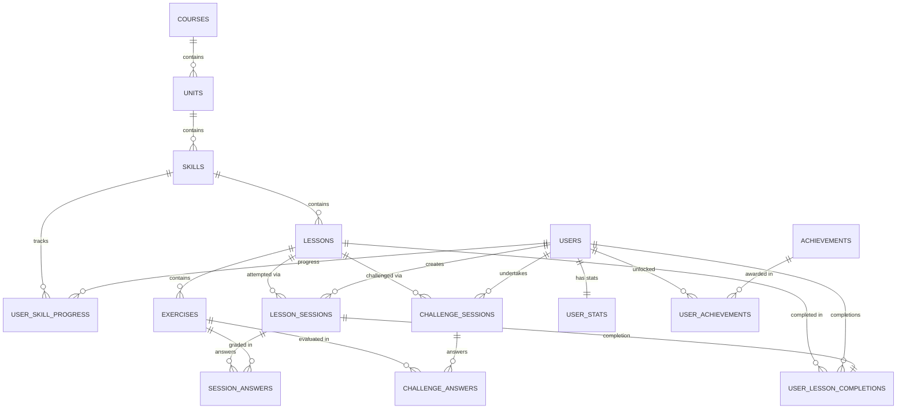

# Duolingo Web App — Full-Stack SDE Implementation

An original, end-to-end full-stack language learning web application inspired by Duolingo. Built with a server-authoritative architecture where all grading, hearts, progression, daily streaks, XP, crowns, and gamification logic are strictly calculated and persisted on the backend.

> *UI is inspired by Duolingo's design patterns; all artwork, sounds, copy, and code are original.*

---

## Live Demo

- **Frontend Application**: [https://duolingo-frontend-5l9g.onrender.com/](https://duolingo-frontend-5l9g.onrender.com/)
- **Backend API**: [https://duolingo-web-app-n2ju.onrender.com/](https://duolingo-web-app-n2ju.onrender.com/)
- **Health Check**: [https://duolingo-web-app-n2ju.onrender.com/api/v1/health](https://duolingo-web-app-n2ju.onrender.com/api/v1/health)

> [!NOTE]
> **Render Free-Tier SQLite Persistence Boundary**:
> - **Survives Browser Navigation & Refreshes**: All learner actions, XP gains, heart deductions, streak updates, and completions are stored server-side in SQLite (`sqlite:///./duolingo.db`) and immediately persist across browser page refreshes and user sessions.
> - **Survives Free Inactivity Sleep/Wake Cycles**: During typical Render Free inactivity spin-downs, the existing container filesystem remains intact; when traffic arrives, the service wakes up with all accumulated user data intact.
> - **Resets on Container Redeploys / Restarts**: Because Render Free tier provides ephemeral container storage without persistent disks, manual redeploys or Render platform instance recreations start with a fresh container. The backend's idempotent `lifespan` startup hook detects the blank database and automatically initializes all tables and seeds the default curriculum and learner (`duo_learner`) without crashes or 500 errors.
> - **Permanent Production Persistence Pathway**: Indefinite persistence across container redeploys would require attaching a Render Persistent Disk (available on Render's paid Starter plan at $7/month + $0.25/GB/month) or migrating to managed PostgreSQL. In accordance with assignment instructions to remain strictly on free-tier services with zero billing, ephemeral SQLite with automatic initialization was selected.

---

## 1. Project Overview

This application provides an interactive Spanish A1 curriculum featuring:
- A progressive learning path with locked, available, and completed lessons.
- An interactive lesson player supporting 5 distinct exercise types.
- A deterministic gamification engine with hearts, passive heart regeneration, daily streaks (Asia/Kolkata), mock gem economy, and weekly league rankings.
- Timed "Legendary" Challenge mode with strict 90-second server countdown, no heart loss, and anti-farming XP protection.
- Duolingo-authentic Dark Mode with zero-flash initial paint and persistent local preference.
- Client-side Spanish Audio/TTS via Web Speech API and responsive sound effects via Web Audio API.
- 100% server authority: zero client-side evaluation, zero answers leaked in API payloads, and duplicate-safe, race-condition-resistant SQLite database transactions.

---

## 2. Tech Stack

- **Frontend**: Next.js 14 (App Router), TypeScript, Tailwind CSS, Lucide Icons, Canvas-Confetti, Google Fonts (Nunito)
- **Backend**: Python 3.10+, FastAPI, SQLAlchemy 2.0, Pydantic v2, Uvicorn
- **Database**: SQLite with Write-Ahead Logging (WAL mode) and enforced Foreign Keys
- **Testing**: Pytest (58 automated unit, API contract, concurrency, and Legendary challenge tests)

---

## 3. Architecture & Separation of Concerns

```
┌─────────────────────────────────────────────────────────────┐
│                   Next.js 14 Frontend                       │
│  - App Router (/ , /lesson/[id] , /leaderboard , /profile)  │
│  - 3D tactile UI design system (Tailwind CSS)               │
│  - Client state renders authoritative backend responses     │
│  - Reverse proxy /api/v1/* -> FastAPI backend              │
└──────────────────────────────┬──────────────────────────────┘
                               │ HTTP / JSON
┌──────────────────────────────▼──────────────────────────────┐
│                    FastAPI Backend                          │
│  - Session Engine: Cryptographic tokens (secrets.token)    │
│  - Sanitizer: Scrubs canonical answers before dispatch      │
│  - Validator Service: NFKD Unicode grading, match sets      │
│  - Concurrency Guard: SQLite WAL + conditional UPDATEs      │
│  - Timezone: Asia/Kolkata streak calculation                │
└──────────────────────────────┬──────────────────────────────┘
                               │ SQLAlchemy ORM (WAL mode)
┌──────────────────────────────▼──────────────────────────────┐
│                  SQLite Database (duolingo.db)              │
│  - 16 Normalized relational tables (incl. challenge tables) │
│  - Unique constraints prevent duplicate submissions/XP      │
└─────────────────────────────────────────────────────────────┘
```

### Key Architectural Decisions
1. **Server Authority**: The frontend never determines if an answer is correct, never awards XP directly, and never unlocks skills locally.
2. **Answer Scrubbing**: Canonical answers, accepted alternatives, and answer keys are scrubbed before payload transmission. Match-pairs exercises decouple left and right items with randomized IDs (`L_0`, `R_2`).
3. **Passive Heart Regeneration**: Heart recovery is deterministic (1 heart per 30 minutes). Pure read calls (`GET /learner/me`) compute effective hearts without database writes; mutating actions synchronize regenerated hearts atomically.
4. **SQLite Concurrency & Idempotency**:
   - Duplicate answer submissions are caught via `(session_id, exercise_id)` uniqueness within savepoint rollbacks (`db.begin_nested()`).
   - Lesson completions use conditional updates (`WHERE status = 'in_progress'`) and a unique constraint on `user_lesson_completions.session_id` to prevent double XP awards under concurrent requests.
5. **Streak Engine**: Calculated in the specified `Asia/Kolkata` timezone. Consecutive days increment streak; practicing on the same day maintains it; missed days reset streak to 1.

---

## 4. Database Schema

The database architecture is built on SQLite (WAL mode, foreign keys enabled) with **16 normalized relational tables** mapped via SQLAlchemy 2.0 models. The schema strictly enforces data integrity through primary keys, foreign key cascading, compound unique constraints, and check constraints.

### Mermaid Entity-Relationship (ER) Diagram



### Table Definitions & Specifications

#### Curriculum Domain
1. **`courses`** (`Course`)
   - **Purpose**: Defines root language courses (e.g., Spanish A1).
   - **Columns**: `id` (PK, int, auto), `code` (string 20, unique, index), `title` (string 100), `target_lang` (string 50).
   - **Relationships**: `units` (1:N cascade delete-orphan).
2. **`units`** (`Unit`)
   - **Purpose**: Curricular sections grouping related skills with specific color themes.
   - **Columns**: `id` (PK, int, auto), `course_id` (FK `courses.id`, int, index), `order_index` (int), `title` (string 100), `description` (text), `hex_color` (string 7, default `#58cc02`).
   - **Constraints**: `UniqueConstraint("course_id", "order_index")`.
   - **Relationships**: Belongs to `courses`; `skills` (1:N cascade delete-orphan).
3. **`skills`** (`Skill`)
   - **Purpose**: Competency nodes rendered on the learning path.
   - **Columns**: `id` (PK, int, auto), `unit_id` (FK `units.id`, int, index), `order_index` (int), `title` (string 100), `icon_name` (string 50), `total_crown_levels` (int, default 5).
   - **Constraints**: `UniqueConstraint("unit_id", "order_index")`.
   - **Relationships**: Belongs to `units`; `lessons` (1:N cascade delete-orphan); `progress` (1:N with `user_skill_progress`).
4. **`lessons`** (`Lesson`)
   - **Purpose**: Individual playable lessons within a skill.
   - **Columns**: `id` (PK, int, auto), `skill_id` (FK `skills.id`, int, index), `order_index` (int), `title` (string 100), `xp_reward` (int, default 15).
   - **Constraints**: `UniqueConstraint("skill_id", "order_index")`.
   - **Relationships**: Belongs to `skills`; `exercises` (1:N cascade delete-orphan); `completions` (1:N); `sessions` (1:N).
5. **`exercises`** (`Exercise`)
   - **Purpose**: Assessment questions belonging to a lesson across 5 supported exercise types.
   - **Columns**: `id` (PK, int, auto), `lesson_id` (FK `lessons.id`, int, index), `order_index` (int), `exercise_type` (string 30: `multiple_choice`, `word_bank`, `match_pairs`, `fill_blank`, `type_answer`), `prompt` (text), `prompt_translation` (text, nullable), `canonical_answer` (text), `payload_json` (text).
   - **Constraints**: `UniqueConstraint("lesson_id", "order_index")`.
   - **Relationships**: Belongs to `lessons`; `session_answers` (1:N cascade delete-orphan).

#### User & Gamification State
6. **`users`** (`User`)
   - **Purpose**: Core learner account identities.
   - **Columns**: `id` (PK, int, auto, index), `username` (string 50, unique, index), `display_name` (string 100), `avatar_url` (string 255, nullable), `created_at` (datetime).
   - **Relationships**: `stats` (1:1 with `user_stats`), `skill_progress` (1:N), `lesson_completions` (1:N), `sessions` (1:N), `achievements` (1:N).
7. **`user_stats`** (`UserStats`)
   - **Purpose**: Authoritative gamification ledger (XP, hearts, gems, streak, and regeneration timestamps).
   - **Columns**: `id` (PK, int, auto, index), `user_id` (FK `users.id`, int, unique, index), `xp` (int, default 0), `hearts` (int, default 5), `max_hearts` (int, default 5), `gems` (int, default 500), `streak` (int, default 0), `last_streak_date` (date, nullable), `last_heart_loss_at` (datetime, nullable).
   - **Constraints**: CheckConstraints: `xp >= 0`, `hearts >= 0 AND hearts <= max_hearts`, `gems >= 0`, `streak >= 0`.
   - **Relationships**: Belongs to `users` (1:1).

#### Lesson Session & Execution
8. **`lesson_sessions`** (`LessonSession`)
   - **Purpose**: Ephemeral, token-guarded lesson attempt sessions.
   - **Columns**: `id` (PK, int, auto, index), `session_token` (string 64, unique, index), `user_id` (FK `users.id`, int, index), `lesson_id` (FK `lessons.id`, int, index), `initial_hearts` (int), `current_hearts` (int), `status` (string 20: `in_progress`, `completed`, `failed`), `started_at` (datetime), `finished_at` (datetime, nullable).
   - **Relationships**: Belongs to `users` & `lessons`; `answers` (1:N cascade delete-orphan); `completion` (1:1 with `user_lesson_completions`).
9. **`session_answers`** (`SessionAnswer`)
   - **Purpose**: Immutable log of learner answer submissions within a lesson session.
   - **Columns**: `id` (PK, int, auto, index), `session_id` (FK `lesson_sessions.id`, int, index), `exercise_id` (FK `exercises.id`, int, index), `submitted_answer` (text), `is_correct` (boolean), `answered_at` (datetime).
   - **Constraints**: `UniqueConstraint("session_id", "exercise_id")` — strictly prevents duplicate heart deductions or repeated answers for the same exercise within a session.
   - **Relationships**: Belongs to `lesson_sessions` & `exercises`.
10. **`user_lesson_completions`** (`UserLessonCompletion`)
    - **Purpose**: Permanent audit record of successful lesson completions and awarded XP.
    - **Columns**: `id` (PK, int, auto, index), `session_id` (FK `lesson_sessions.id`, int, unique, index), `user_id` (FK `users.id`, int, index), `lesson_id` (FK `lessons.id`, int, index), `xp_earned` (int, default 15), `completed_at` (datetime).
    - **Constraints**: Unique index on `session_id` ensures idempotent completion calls.
    - **Relationships**: Belongs to `lesson_sessions`, `users`, and `lessons`.
11. **`user_skill_progress`** (`UserSkillProgress`)
    - **Purpose**: Tracks learner advancement per skill (crown levels and current lesson index).
    - **Columns**: `id` (PK, int, auto, index), `user_id` (FK `users.id`, int, index), `skill_id` (FK `skills.id`, int, index), `crowns` (int, default 0), `current_lesson_index` (int, default 0), `is_completed` (boolean, default False).
    - **Constraints**: `UniqueConstraint("user_id", "skill_id")`.
    - **Relationships**: Belongs to `users` & `skills`.

#### Gamification & Social
12. **`achievements`** (`Achievement`)
    - **Purpose**: System achievement catalog.
    - **Columns**: `id` (PK, int, auto, index), `code` (string 50, unique, index), `title` (string 100), `description` (text), `icon_name` (string 50).
    - **Relationships**: `user_achievements` (1:N cascade delete-orphan).
13. **`user_achievements`** (`UserAchievement`)
    - **Purpose**: Record of unlocked achievements per learner.
    - **Columns**: `id` (PK, int, auto, index), `user_id` (FK `users.id`, int, index), `achievement_id` (FK `achievements.id`, int, index), `unlocked_at` (datetime).
    - **Constraints**: `UniqueConstraint("user_id", "achievement_id")` prevents duplicate achievement unlocking.
    - **Relationships**: Belongs to `users` & `achievements`.
14. **`leaderboard_users`** (`LeaderboardUser`)
    - **Purpose**: Seeded mock competitor profiles with benchmark weekly XP for league rankings.
    - **Columns**: `id` (PK, int, auto, index), `username` (string 50, unique, index), `display_name` (string 100), `avatar_url` (string 255), `weekly_xp` (int, default 0).

#### Timed "Legendary" Challenge Domain
15. **`challenge_sessions`** (`ChallengeSession`)
    - **Purpose**: Active or finished 90-second Timed Challenge sessions.
    - **Columns**: `id` (PK, int, auto, index), `challenge_token` (string 64, unique, index), `user_id` (FK `users.id`, int, index), `lesson_id` (FK `lessons.id`, int, index), `time_limit_seconds` (int, default 90), `started_at` (datetime), `expires_at` (datetime), `finished_at` (datetime, nullable), `status` (string 20: `in_progress`, `completed`, `timed_out`, `failed`), `xp_awarded` (int, default 0), `is_first_completion` (boolean, default False).
    - **Relationships**: Belongs to `users` & `lessons`; `answers` (1:N with `challenge_answers` cascade delete-orphan).
16. **`challenge_answers`** (`ChallengeAnswer`)
    - **Purpose**: Submissions within a timed challenge session.
    - **Columns**: `id` (PK, int, auto, index), `challenge_id` (FK `challenge_sessions.id`, int, index), `exercise_id` (FK `exercises.id`, int, index), `submitted_answer` (text), `is_correct` (boolean), `answered_at` (datetime).
    - **Constraints**: `UniqueConstraint("challenge_id", "exercise_id")`.
    - **Relationships**: Belongs to `challenge_sessions` & `exercises`.

---

## 5. Project Structure

```
duolingo-app/
├── backend/
│   ├── app/
│   │   ├── models/            # SQLAlchemy models (user, course, exercise, session, challenge)
│   │   ├── routers/           # FastAPI endpoints (learner, path, session, leaderboard, challenge)
│   │   ├── schemas/           # Pydantic v2 validation DTOs (session, challenge, learner)
│   │   ├── seeds/             # Curriculum seeder (Spanish A1, default learner, rankings)
│   │   ├── services/          # Authoritative business logic (grading, sessions, streak, challenge)
│   │   ├── config.py          # Application settings & environment variables
│   │   ├── database.py        # SQLite engine with WAL pragma & session factory
│   │   └── main.py            # FastAPI app lifecycle & CORS configuration
│   ├── tests/                 # 58 automated unit, concurrency, and challenge tests
│   ├── .python-version        # Pinned Python version (3.13.5) for Render deployment
│   └── requirements.txt       # Python dependencies
├── frontend/
│   ├── app/                   # Next.js App Router pages (/, /lesson/[id], /challenge/[id], /leaderboard, /quests, /shop, /profile, /settings, /more)
│   ├── components/
│   │   ├── layout/            # TopHeader, Sidebar, BottomNav
│   │   ├── lesson/            # LessonHeader, FeedbackBar, Complete/Failed modals
│   │   │   └── exercises/     # Renderers for all 5 exercise types
│   │   ├── mascot/            # Original SVG mascot ("Pepito") with 6 emotional states
│   │   ├── path/              # UnitHeader, SkillNode, LessonModal, PathConnector
│   │   ├── theme/             # ThemeProvider & Dark Mode toggle
│   │   └── ui/                # Tactile 3D Buttons, Cards, Modals, ProgressBars, AudioButton
│   ├── lib/                   # API client (lib/api.ts), types (lib/types.ts), audio (lib/audio.ts)
│   ├── public/                # Static brand assets and SVGs
│   ├── next.config.js         # Configurable reverse proxy rewrite rules
│   ├── package.json           # Frontend dependencies
│   └── tailwind.config.js     # Duolingo color palette and design tokens
├── .gitignore                 # Root gitignore excluding dependencies and runtime files
└── README.md                  # Project documentation
```

---

## 6. Prerequisites

- **Python**: 3.10 or higher
- **Node.js**: 18.17.0 or higher
- **npm**: 9.0.0 or higher

---

## 7. Installation & Setup

### A. Backend Setup

1. Open a terminal in the `backend/` directory:
   ```bash
   cd backend
   ```

2. Create and activate a Python virtual environment:
   - **Windows**:
     ```powershell
     python -m venv venv
     venv\Scripts\activate
     ```
   - **macOS / Linux**:
     ```bash
     python3 -m venv venv
     source venv/bin/activate
     ```

3. Install backend dependencies:
   ```bash
   pip install -r requirements.txt
   ```

4. Initialize and seed the SQLite database:
   ```bash
   python -m app.seeds.seeder --reset
   ```
   *(Creates tables and seeds Spanish A1 curriculum, achievements, leaderboard competitors, and default learner `duo_learner`)*.

5. Start the backend development server:
   ```bash
   uvicorn app.main:app --host 127.0.0.1 --port 8000 --reload
   ```
   - API Base: `http://127.0.0.1:8000`
   - Interactive Swagger Docs: `http://127.0.0.1:8000/docs`

---

### B. Frontend Setup

1. Open a separate terminal in the `frontend/` directory:
   ```bash
   cd frontend
   ```

2. Install npm dependencies:
   ```bash
   npm install
   ```

3. Run the development server:
   ```bash
   npm run dev
   ```
   - Application URL: `http://localhost:3000`

4. *(Optional)* Build and run the production server:
   ```bash
   npm run build
   npm run start
   ```

---

## 8. API Specification Overview

All endpoints are prefixed with `/api/v1`:

| Method | Endpoint | Description | Auth / Access |
|---|---|---|---|
| `GET` | `/health` | Server health check and version | Public |
| `GET` | `/learner/me` | Fetch learner profile, hearts, gems, streak, daily XP, achievements | Authoritative user |
| `POST` | `/learner/refill-hearts` | Restore hearts to 5 for 350 gems | Authoritative user |
| `POST` | `/learner/practice-heart` | Free practice session (+1 heart, 0 XP) | Authoritative user |
| `GET` | `/courses/active/tree` | Learning path with units, skills, and locked/available/completed states | Authoritative user |
| `GET` | `/lessons/{id}/status` | Validate lesson availability and prerequisite locks | Authoritative user |
| `POST` | `/lessons/{id}/start` | Initialize lesson session; returns sanitized exercise payloads | Authoritative user |
| `POST` | `/lessons/sessions/{token}/answer` | Authoritatively grades answer; deducts hearts on error | Session owner |
| `POST` | `/lessons/sessions/{token}/complete` | Finalizes lesson; awards XP (15 first / 5 replay), crowns, streak | Session owner |
| `POST` | `/challenges/{lesson_id}/start` | Initialize Legendary timed challenge (90s server clock); returns sanitized exercises | Authoritative user |
| `GET` | `/challenges/sessions/{challenge_token}` | Authoritative challenge status, remaining countdown seconds, and expiry state | Session owner |
| `POST` | `/challenges/sessions/{challenge_token}/answer` | Evaluates challenge answer; strictly rejects late submissions past 90s server deadline | Session owner |
| `POST` | `/challenges/sessions/{challenge_token}/complete` | Finalizes challenge; awards +20 XP on first completion / 0 XP on replay; idempotent | Session owner |
| `GET` | `/leaderboard` | Weekly leaderboard standings with dynamic days remaining (Monday-to-Sunday league window) | Authoritative user |

Interactive API documentation with request schemas and live testing is available at `http://127.0.0.1:8000/docs`.

---

## 9. Exercise Types Supported

The application implements all 5 required exercise types with dedicated UI components and server validators:

1. **Multiple Choice** (`multiple_choice`): Single-choice selection with keyboard badges (`1`, `2`, `3`).
2. **Translate / Word Bank** (`word_bank`): Interactive token bank where tiles dynamically snap into the sentence assembly slot and can be returned by clicking.
3. **Match Pairs** (`match_pairs`): Two-column card matching with decoupled left/right item IDs (`L_x`, `R_y`), animated selection outlines, and bidirectional set validation.
4. **Fill in the Blank** (`fill_blank`): Sentence template with an inline blank slot filled by selectable options.
5. **Type the Answer** (`type_answer`): Freeform Spanish text input with a virtual Spanish accent bar (`á`, `é`, `í`, `ó`, `ú`, `ñ`, `¿`, `¡`) and NFKD Unicode normalization on the server.

### Timed "Legendary" Challenge Mode
In addition to standard lessons, learners can launch a Timed Legendary Challenge for any unlocked lesson (`/challenge/[id]`):
- **90-Second Server-Authoritative Timer**: Challenge deadline is tracked and strictly enforced on the server (`expires_at = started_at + 90s`). Answers submitted after time expires are rejected with HTTP 400.
- **No Strikes & No Heart Loss**: Challenges test speed; incorrect answers display corrections without deducting learner hearts and without a strikes limit.
- **Anti-Farming XP Rewards**: Completing the challenge awards **+20 XP** on first successful completion and **0 XP** on replay.
- **Completion Idempotency**: Subsequent completion calls return the completed state without granting duplicate XP.
- **Session Isolation**: Challenge sessions (`challenge_sessions` and `challenge_answers`) are tracked in dedicated tables completely isolated from standard lesson progress.

---

## 10. Seeded Content & Default Learner

The database seeder automatically configures:
- **Default Learner**:
  - Username: `duo_learner` (Alex Developer)
  - Initial State: 5 hearts, 500 gems, 5-day streak, 300+ lifetime XP
  - Progress: Skill 1 ("Greetings") completed (5 crowns); Skill 2 ("Food & Drinks") partially completed with Lesson 2 ("Daily Meals") available to play.
- **Curriculum**:
  - Course: Spanish A1 (`es-en`)
  - 2 Units: "Unit 1: Rookie Basics", "Unit 2: Daily Life"
  - 4 Skills: Greetings, Food & Drinks, Basic Phrases, Travel
  - 8 Lessons with 40 exercises covering all 5 exercise formats.
- **Leaderboard**: 9 seeded competitive learners with realistic weekly XP distribution.
- **Achievements**: 4 achievements ("First Steps", "Wildfire", "Centurion", "Flawless Victory").

---

## 11. Automated Tests

The backend test suite contains **58 comprehensive automated tests**:

```bash
cd backend
venv\Scripts\python -m pytest -v
```

### Test Coverage Highlights:
- `test_phase1_database.py` (8 tests): Relational schema integrity, foreign key cascades, unique constraints, seeder idempotency.
- `test_phase2_apis.py` (21 tests): Passive heart regeneration without database mutation, gem deduction, free practice, course tree status transitions, weekly leaderboard XP aggregation, Asia/Kolkata active and stale streak evaluation.
- `test_phase3_lesson_engine.py` (23 tests):
  - Lock enforcement: 403 on locked lessons or 0 hearts.
  - Payload sanitization: verified absence of `canonical_answer`, `accepted_answers`, `answer_key`.
  - Server grading for all 5 exercise types.
  - Multi-threaded concurrency tests under SQLite WAL mode: concurrent duplicate wrong answers (single heart loss), concurrent duplicate correct answers, concurrent completion race conditions.
- `test_phase4_legendary_mode.py` (6 tests):
  - 90-second server countdown deadline enforcement.
  - Late answer rejection past server expiry.
  - First-time Legendary bonus (+20 XP) and anti-farming replay protection (0 XP).
  - Daily and weekly leaderboard XP aggregation from challenge completions.
  - Idempotent completion and session isolation from normal lessons.

---

## 12. Environment Configuration

### Backend Variables (`backend/.env` or system environment):
```bash
DATABASE_URL=sqlite:///./duolingo.db    # SQLite database connection URL
DEFAULT_TIMEZONE=Asia/Kolkata           # Timezone for streaks and daily boundaries
MAX_HEARTS=5                            # Maximum learner hearts capacity
HEART_REGEN_SECONDS=1800                # Passive heart regeneration interval (30 min)
GEM_REFILL_COST=350                     # Cost to refill hearts with gems
BASE_LESSON_XP=15                       # XP awarded for first-time completion
REPLAY_LESSON_XP=5                      # XP awarded for replay completion
ALLOW_DEV_USER_OVERRIDE=false           # Dev security flag for X-User-Id header override
CORS_ORIGINS=http://localhost:3000,http://127.0.0.1:3000   # Comma-separated allowed origins
```

### Frontend Variables (`frontend/.env.local` or deployment settings):
```bash
# Internal backend URL used by the Next.js server reverse proxy:
BACKEND_INTERNAL_URL=http://127.0.0.1:8000

# Optional public override for client-side fetches (defaults to /api/v1 in browser):
NEXT_PUBLIC_API_URL=
```

---

## 13. Deployment Instructions

### Render Free Tier Deployment (Automated Blueprint)
The project includes a root `render.yaml` Blueprint configured 100% for **Render Free tier** (`plan: free` for both services, zero cost, no persistent disks or paid add-ons required):

1. **Deploy with Blueprint**:
   - Push repository to GitHub.
   - In Render Dashboard, click **New +** -> **Blueprint**.
   - Connect this GitHub repository (`kashvimittal02/duolingo-web-app`).
   - Render automatically provisions:
     - `duolingo-backend`: Python Web Service (`plan: free`, `rootDir: backend`, `startCommand: uvicorn app.main:app --host 0.0.0.0 --port $PORT`).
     - `duolingo-frontend`: Node.js Web Service (`plan: free`, `rootDir: frontend`, `startCommand: npm run start`).
2. **Ephemeral SQLite on Render Free & Persistence Boundaries**:
   - Render Free tier web services utilize an ephemeral container filesystem (`DATABASE_URL=sqlite:///./duolingo.db`).
   - **Page Reloads**: Learner XP, streaks, hearts, crowns, and completed lessons persist across page reloads because all transactions are committed to the backend SQLite database.
   - **Inactivity Sleep/Wake**: Container filesystems persist across routine idle spin-downs; waking up preserves ongoing learner state.
   - **Container Restarts/Redeploys**: Because persistent disks are not supported on Render Free tier, service redeploys provision a new container instance. The backend's non-destructive `lifespan` startup hook detects the fresh database and automatically initializes tables and seeds default curriculum and learner data (`duo_learner`) with zero downtime or crash errors.
   - **Production Disk Upgrade**: To achieve 100% durable persistence across redeploys, Render requires an active persistent disk on their paid Starter plan ($7/mo instance + $0.25/GB/mo storage). In strict adherence to assignment requirements prohibiting paid cloud add-ons, ephemeral SQLite with automatic initialization was maintained.
   - No build-time database generation or external database migrations are required.
3. **Networking & CORS**:
   - `BACKEND_INTERNAL_URL` is automatically wired via Render's service discovery (`property: host`).
   - The Next.js reverse proxy (`/api/:path*`) routes client traffic securely to the FastAPI backend without exposing localhost.
   - `CORS_ORIGINS` is automatically configured to accept requests from the deployed frontend origin without wildcard CORS.

---

## 14. Known Assumptions & Scope Decisions

- **Authentication**: As permitted by the assignment specification, authentication defaults to the seeded learner `duo_learner` without requiring user registration or passwords.
- **Audio / TTS & Sound Effects**: Fully implemented client-side using native browser Web Speech API (`window.speechSynthesis` prioritizing `es-ES` Spanish pronunciation) and the Web Audio API (harmonic synthesizer for correct/incorrect responses and completion celebrations). Includes interactive audio replay buttons and global sound muting toggle.
- **Currency**: Gems are mock currency seeded with the learner; no real payments or external billing APIs are integrated.
